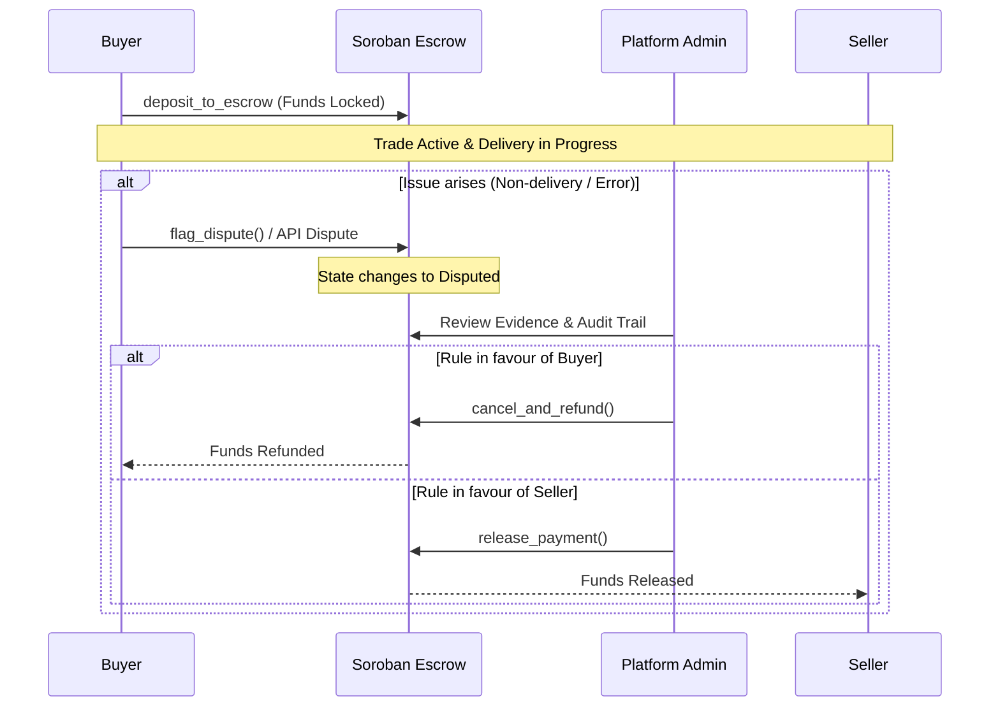

# Escrow Dispute Flow

This guide outlines the end-to-end dispute flow in the AirFlex P2P marketplace, covering how disputes are raised, the arbitration process, timelock windows, and how funds are settled upon resolution.

## Overview

When a trade is initiated, the buyer's funds are securely locked in the Soroban-powered Escrow smart contract on the Stellar network. Under normal circumstances, once the seller delivers the airtime or data and the buyer confirms receipt, funds are released to the seller.

However, if an issue arises—such as non-delivery, incorrect amounts, or communication breakdowns—either party can flag a dispute.

## Roles and Permissions

| Role | Description | Key Permissions |
| :--- | :--- | :--- |
| **Buyer** | The user purchasing airtime or data who locks funds in escrow. | • Can deposit funds • Can confirm delivery • Can flag a dispute within the dispute window • Can request a refund if timed out |
| **Seller** | The user providing airtime or data. | • Can create listings • Can submit fulfillment proof • Can flag a dispute if payment confirmation is blocked |
| **Arbitrator (Admin)** | Neutral platform authority governing dispute resolution. | • Can review dispute evidence and audit logs • Can resolve disputes by releasing funds to seller or refunding buyer • Can enforce platform penalties or bans for bad actors |

## The Dispute Window & Escrow Timelock

- **Dispute Window**: The active time frame following trade locking during which a buyer or seller can raise a dispute (`flag_dispute`). If no dispute is raised before the window closes, the trade becomes eligible for finalization.
- **Timelock Window**: Enforced at the smart contract level, the timelock prevents premature withdrawal or unauthorized cancellation. If a trade remains inactive or unresolved past the timelock expiration without an active dispute, safety fallback mechanisms allow refunds to the rightful owner.

## End-to-End Dispute State Transitions

## Step-by-Step Resolution Process

1. **Initiation**: A party clicks **Flag Dispute** on the trade detail view (`/trades/[id]/dispute`) or invokes `flag_dispute` directly on the Soroban escrow contract.
2. **Freezing State**: The trade status transitions to `Disputed`. Smart contract execution is paused for normal completion, locking funds securely in escrow.
3. **Evidence Submission**: Both buyer and seller submit relevant telecom receipts, transaction IDs, and communication logs through the support portal or API.
4. **Arbitration Review**: Platform administrators inspect the cryptographic transaction hashes on the Stellar ledger along with platform audit logs.
5. **Final Settlement**: 
   - If the seller's proof of delivery is valid, the arbitrator executes `release_payment` to disburse funds to the seller.
   - If delivery failed or fraud is detected, the arbitrator executes `cancel_and_refund` to return funds to the buyer's Stellar wallet.

## Related References

- [Escrow Contract Reference](/contract-reference/escrow)
- [Trades API Reference](/api-reference/trades)
