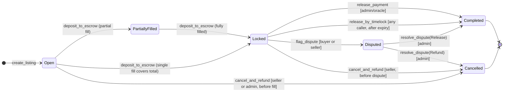

# Escrow Dispute Flow

This guide documents the complete dispute lifecycle in the AirFlex P2P marketplace — from the moment a party flags a problem through admin resolution, fund release, and all notable edge cases.

## Overview

When a trade is initiated, the buyer's funds are locked in the Soroban-powered Escrow smart contract on the Stellar network. Under normal circumstances, once the seller delivers and the buyer confirms receipt, funds are released to the seller via `release_payment`.

If something goes wrong, either the buyer or the seller can call `flag_dispute` to escalate. From that point the admin arbitrator reviews evidence and calls `resolve_dispute` with either `Release` (seller wins) or `Refund` (buyer wins).

---

## Roles and Permissions

| Role | Description | Key Permissions |
| :--- | :--- | :--- |
| **Buyer** | Locks funds in escrow to purchase airtime or data. | Deposit funds, confirm delivery, flag dispute within window, request refund on timelock expiry |
| **Seller** | Creates the listing and delivers the asset. | Create listings, flag dispute if payment confirmation is blocked, receive payment on `Release` |
| **Arbitrator (Admin)** | The platform admin key stored at contract deploy time. | Call `resolve_dispute`, `cancel_and_refund`, `release_payment`, `emergency_withdraw` |

---

## Dispute States

The contract defines these `TradeStatus` variants relevant to the dispute lifecycle:

| State | Meaning |
| :--- | :--- |
| `Locked` | Trade fully funded; delivery in progress. Only state from which `flag_dispute` succeeds. |
| `Disputed` | A party called `flag_dispute`. Funds are frozen; only the admin may move them. |
| `Completed` | Admin resolved in favour of the seller (`resolve_dispute(Release)`), or delivery was confirmed normally. Terminal. |
| `Cancelled` | Admin resolved in favour of the buyer (`resolve_dispute(Refund)`), or seller cancelled before fill. Terminal. |

> **Note on `UnderReview` / `Escalated` / `ResolvedBuyer` / `ResolvedSeller`:** These are platform-layer concepts tracked in the PostgreSQL database by the API server. The smart contract uses `Disputed` for the entire arbitration period and resolves it atomically to `Completed` or `Cancelled`. The API layer may expose finer-grained labels (`under_review`, `escalated`, `resolved_buyer`, `resolved_seller`) in the `trade_offers` table for UI and audit trail purposes.

---

## State Machine Diagram



**Valid transitions summary:**

| From | To | Trigger | Caller |
| :--- | :--- | :--- | :--- |
| `Open` | `PartiallyFilled` | `deposit_to_escrow` (partial) | Buyer |
| `Open` / `PartiallyFilled` | `Locked` | `deposit_to_escrow` (fully fills) | Buyer |
| `Open` | `Cancelled` | `cancel_and_refund` | Seller or Admin |
| `Locked` | `Completed` | `release_payment` | Admin |
| `Locked` | `Completed` | `release_by_timelock` | Anyone (after expiry) |
| `Locked` | `Disputed` | `flag_dispute` | Buyer or Seller |
| `Locked` | `Cancelled` | `cancel_and_refund` | Seller (before dispute) |
| `Disputed` | `Completed` | `resolve_dispute(Release)` | Admin |
| `Disputed` | `Cancelled` | `resolve_dispute(Refund)` | Admin |

---

## Dispute Window and Cooldown

- **Dispute window:** A party may call `flag_dispute` at any time while the trade is `Locked`. There is no on-chain expiry preventing a dispute — however, the API layer enforces a platform-defined deadline stored in `DataKey::DisputeWindowCloseAt`.
- **Dispute cooldown (issue #642):** A repeat call to `flag_dispute` on the same trade is rejected with `ContractError::DisputeCooldownActive` until `dispute_cooldown_seconds` have elapsed since the last flag. The default cooldown is **3600 seconds (1 hour)**. This prevents spam that would exhaust the counterparty's response window or game resolution timing.
- **Emergency timelock:** If a contract is paused for more than **72 hours**, the admin may call `emergency_withdraw` to recover trapped funds.

---

## End-to-End Dispute Flow

### 1. Flag the dispute

Either the buyer or seller calls `flag_dispute`. The trade must be `Locked`; `PartiallyFilled` trades are rejected because delivery has not been attempted yet.

```
POST /api/v1/trades/{trade_id}/dispute
Authorization: Bearer <jwt>
```

The API server validates the caller is a party to the trade, then invokes `flag_dispute(caller, trade_id)` on the escrow contract via the Soroban RPC.

**On-chain:** `TradeStatus` transitions from `Locked` → `Disputed`. The contract emits a `disputed` event and an `escrow_disputed` event carrying `(trade_id, caller, filled_amount, timestamp)`.

**Off-chain:** The API stores `status = 'disputed'` and creates a `disputes` record. An admin notification is queued.

---

### 2. Evidence submission

Both parties submit evidence through the platform portal or API:

```
POST /api/v1/disputes/{dispute_id}/evidence
Content-Type: multipart/form-data

file=<receipt or screenshot>
description=<text>
```

Evidence is stored off-chain (S3/database). The admin dashboard surfaces both sides' submissions alongside the Stellar transaction hashes for the deposit sub-escrows.

---

### 3. Admin review

The admin queries the trade state:

```
GET /api/v1/admin/trades/{trade_id}
GET /api/v1/admin/disputes/{dispute_id}/evidence
```

The admin can inspect each sub-escrow fill and the on-chain event log via Stellar Explorer. The contract function to read trade state directly:

```
get_trade(env, trade_id) → TradeOffer
```

See [`contracts/escrow/src/lib.rs` — `get_trade`](../../contracts/escrow/src/lib.rs).

---

### 4. Admin resolution

The admin calls `resolve_dispute` with one of two outcomes:

#### Release — seller prevails

```
POST /api/v1/admin/disputes/{dispute_id}/resolve
{
  "resolution": "release"
}
```

The API server invokes:

```rust
resolve_dispute(env, trade_id, DisputeResolution::Release)
```

**Effect:** Every unsettled sub-escrow is transferred to the seller. `TradeStatus` → `Completed`. The contract emits a `resolved` event per fill and a `completed` event on the trade.

#### Refund — buyer prevails

```
POST /api/v1/admin/disputes/{dispute_id}/resolve
{
  "resolution": "refund"
}
```

The API server invokes:

```rust
resolve_dispute(env, trade_id, DisputeResolution::Refund)
```

**Effect:** Every unsettled sub-escrow is returned to the respective buyer. `TradeStatus` → `Cancelled`. The contract emits a `resolved` event per fill and a `cancelled` event on the trade.

> **Important:** Fills that were already settled (released or refunded) before the dispute was raised are skipped. Only sub-escrows with `released == false && refunded == false` are moved.

See [`contracts/escrow/src/lib.rs` — `resolve_dispute`](../../contracts/escrow/src/lib.rs).

---

## Edge Cases

### Dispute filed after the dispute window closes

The dispute window is a platform-layer concept enforced by the API (`DataKey::DisputeWindowCloseAt`). If the API rejects a late flag, the trade may still become eligible for `release_by_timelock` once the escrow's `expires_at` has passed. The on-chain contract itself does not gate `flag_dispute` on window expiry — only the API middleware does. Callers who bypass the API and invoke the contract directly after the window may still succeed on-chain; the resulting disputed state will be treated as a valid escalation by the admin.

### Both parties flag the dispute simultaneously

`flag_dispute` is idempotent for `Locked` trades: calling it when the trade is already `Disputed` is accepted (it re-escalates and updates `LastDisputeAt`). The dispute cooldown (1 hour) prevents immediate re-flagging. Both parties flagging in sequence before the cooldown elapses results in only the first call succeeding; the second is rejected with `DisputeCooldownActive`. This is intentional — it prevents race-based spam, and the admin's resolution authority covers all fills regardless of which party flagged.

### Admin resolves in favour of neither party

The smart contract's `resolve_dispute` accepts only `Release` (seller) or `Refund` (buyer). There is no on-chain "split" outcome. For partial settlements or negotiated splits the admin must:

1. Call `release_payment` for specific fill IDs that the seller delivered.
2. Call `cancel_and_refund` for specific fill IDs that were not delivered.
3. Only after all fills are individually settled, call `resolve_dispute` — which will find no unsettled fills and simply transition the trade status.

Alternatively, the admin can manually coordinate off-chain transfers and document the outcome in the dispute record before resolving the on-chain state.

### Dispute filed after `expires_at`

Once a trade's `expires_at` timestamp has passed, `close_expired_listing` can be called by anyone to cancel unfilled capacity. However, if the trade is `Locked` (already filled), expiry does not prevent a dispute — it only blocks new deposits. A buyer may still call `flag_dispute` on a `Locked` trade after expiry, and the dispute flow proceeds normally.

### Emergency withdrawal while `Disputed`

If the contract is paused (e.g. due to a critical bug) and `emergency_withdraw` is called after the 72-hour timelock, funds are recovered directly by the admin regardless of trade status, including `Disputed`. This is a last-resort safety valve and emits a high-severity `emergency_withdrawal` event on-chain.

---

## Relevant Contract Functions

All functions are in [`contracts/escrow/src/lib.rs`](../../contracts/escrow/src/lib.rs).

| Function | Caller | Description |
| :--- | :--- | :--- |
| [`flag_dispute`](../../contracts/escrow/src/lib.rs) | Buyer or Seller | Transitions `Locked` → `Disputed`; enforces cooldown |
| [`resolve_dispute`](../../contracts/escrow/src/lib.rs) | Admin | Settles all unsettled fills; transitions `Disputed` → `Completed` or `Cancelled` |
| [`release_payment`](../../contracts/escrow/src/lib.rs) | Admin | Releases a single fill to the seller; for pre-dispute settlement |
| [`cancel_and_refund`](../../contracts/escrow/src/lib.rs) | Seller or Admin | Refunds a single fill to its buyer |
| [`release_by_timelock`](../../contracts/escrow/src/lib.rs) | Anyone | Releases all fills to seller after `expires_at` (not usable on `Disputed` trades) |
| [`emergency_withdraw`](../../contracts/escrow/src/lib.rs) | Admin | Recovers funds when paused for > 72 hours |
| [`get_trade`](../../contracts/escrow/src/lib.rs) | Read-only | Returns the current `TradeOffer` including `status` |
| [`get_dispute_window_close_at`](../../contracts/escrow/src/lib.rs) | Read-only | Returns the platform dispute window deadline timestamp |

---

## Related References

- [Escrow Contract Reference](/contract-reference/escrow)
- [Trades API Reference](/api-reference/trades)
- [Architecture Overview](/docs/architecture)
