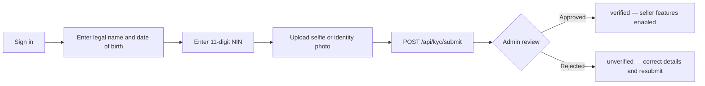
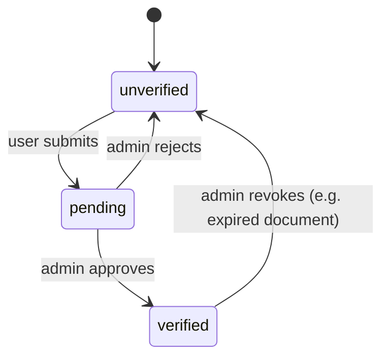

import { Callout } from "nextra/components";

# Seller KYC onboarding

Seller verification (KYC) is required before you can create a trade listing.
The `/kyc` flow collects your legal name, date of birth, Nigerian National
Identification Number (NIN), and a selfie or identity document photo.

Everything on this page reflects the current server behaviour in
[`server/src/routes/kyc.ts`](https://github.com/arflexx/Airflex/blob/main/server/src/routes/kyc.ts),
[`server/src/routes/admin.ts`](https://github.com/arflexx/Airflex/blob/main/server/src/routes/admin.ts),
[`server/src/middleware/rateLimitKyc.ts`](https://github.com/arflexx/Airflex/blob/main/server/src/middleware/rateLimitKyc.ts)
and [`server/src/jobs/kycExpiry.ts`](https://github.com/arflexx/Airflex/blob/main/server/src/jobs/kycExpiry.ts).

## Supported documents and coverage

| | Supported |
| --- | --- |
| **Country coverage** | **Nigeria only.** Verification is keyed on the Nigerian NIN; no other national ID number is accepted. |
| **Identity number** | NIN — exactly 11 digits. |
| **Document photo** | One image: a selfie or a photo of your identity document. |
| **File formats** | JPEG (`image/jpeg`) or PNG (`image/png`). PDFs, HEIC and other formats are rejected. |
| **Maximum size** | 5 MB, one file per submission. |
| **Personal details** | Legal name (at least first and last name) and a date of birth in the past. |

The form does not distinguish document classes (passport, driver's licence,
voter's card); submit the document requested by the in-app instructions, and
make sure the name and date of birth match it exactly.

## Submission flow



Open **Complete KYC** in the app, complete each step and submit. The document
is streamed to the configured object store and your account moves to
**Pending**. An admin then approves or rejects it via
`PATCH /api/v1/admin/users/:id/kyc`; each decision is recorded in the admin
audit log as `kyc.approved` or `kyc.rejected`, with the reviewer's optional note.

## Status lifecycle

The server stores exactly three values in `users.kyc_status`, enforced by a
database `CHECK` constraint (migration `017_kyc_status_enum.sql`). **Rejected**
and **Expired** are user-facing situations, not stored statuses.



| Status | Stored value | What it means for you | System state |
| --- | --- | --- | --- |
| **Unverified** | `unverified` (default) | No approved verification. You can buy, but cannot create listings. | `POST /api/v1/trades` returns `403` with code `KYC_REQUIRED`. Submissions are accepted. |
| **Pending** | `pending` | Your submission was received and is awaiting review. | Listings still blocked. A new submission is refused with `400 "KYC submission is already pending review."` |
| **Approved / Verified** | `verified` | You are a verified seller. | Listings allowed. A new submission is refused with `400 "KYC is already verified."` |
| **Rejected** | `unverified` (+ audit entry `kyc.rejected`) | The reviewer did not approve the submission. | Identical to Unverified: you may resubmit (subject to the rate limit below). |
| **Expired** | `verified` or `unverified` + `kyc_document_expiry` in the past | Your identity document's expiry date has passed or is near. | See [Document expiry](#document-expiry-and-renewal). |

The profile endpoint (`GET /api/v1/profile`) reports `kycStatus` as one of
`unverified`, `pending` or `verified`.

## Review timeline (SLA)

<Callout type="info">
  **Target: initial review within 24–48 hours** of submission (issue #691).
  Reviews are manual and there is no automatic approval or timeout, so a
  submission stays **Pending** until an admin acts on it. Submissions made
  over weekends or public holidays may take longer.
</Callout>

If your submission has been pending for more than 48 hours, contact support
and quote the `X-Request-ID` header from your submission response so the team
can find it in the server logs.

## Document expiry and renewal

- **When it expires:** each account can carry a `kyc_document_expiry` date — the
  expiry date of the identity document on file.
- **Warning trigger:** a daily background job (`kyc-document-expiry`) finds every
  account whose document expires within `KYC_EXPIRY_WARNING_DAYS` days
  (default **30**) or has already expired. Each affected user gets at most one
  SMS per day: *"Your KYC document expires on `<date>`. Please renew it in the
  app to keep your account active."* Admins receive a daily summary
  (`KYC_ADMIN_SUMMARY`) with the count of affected accounts.
- **What is restricted:** expiry itself does not change `kyc_status`
  automatically. An admin reviews the summary and, if the document has lapsed,
  sets the account back to `unverified`. From that point the account loses
  verified-seller features: **creating new trade listings is blocked**
  (`403 KYC_REQUIRED`). Existing trades in progress are not cancelled.
- **How to renew:** once your status is `unverified`, submit a fresh KYC
  application with a current, valid document through **Complete KYC**. It goes
  through the normal review flow above. A submission is refused while you are
  still `verified`, so renewal starts after the admin downgrade.

## Re-submission after rejection

A rejection returns the account to `unverified`, which allows a new
submission. The reviewer's note is stored in the audit log but is not yet
returned to the app, so check these common causes before resubmitting:

1. The legal name has at least two words and matches your document.
2. The date of birth is valid, in the past, and matches your document.
3. The NIN is exactly 11 digits.
4. The photo is JPEG or PNG, at most 5 MB, sharp, and shows the whole document.

Submitting replaces the previous document: the old object is deleted from
storage and the new submission moves back to **Pending**.

### Validation errors

| HTTP | Error | Cause |
| --- | --- | --- |
| `400` | `Invalid multipart form data or upload error.` | Malformed upload or storage failure. |
| `400` | `KYC submission is already pending review.` | Status is `pending`. |
| `400` | `KYC is already verified.` | Status is `verified`. |
| `422` | `Only JPEG or PNG images are accepted.` | Wrong file type. |
| `422` | `File size must not exceed 5 MB.` | File too large. |
| `422` | `Full legal name must contain at least two words.` / `Enter a valid date of birth.` / `NIN must be exactly 11 digits.` / `Document photo is required.` | Field validation. |

### Rate limit

`POST /api/kyc/submit` is limited per user by `rateLimitKyc`:

| Rule | Value |
| --- | --- |
| Limit | **3 submissions** per user (`KYC_MAX_SUBMISSIONS`, default 3) |
| Window | **Rolling 60 minutes** (`KYC_WINDOW_MINUTES`, default 60) — a sliding window, not a fixed hourly reset |
| Keyed on | Authenticated user ID (request IP as a fallback) |
| Counted | **Every attempt**, including failed or rejected ones — the attempt is recorded before the check |
| Storage | PostgreSQL (`kyc_submission_attempts`), so the limit holds across restarts and instances |

Every response includes:

- `X-RateLimit-Limit` — the maximum submissions in the window.
- `X-RateLimit-Remaining` — submissions left in the current window.

When the limit is exceeded the server responds with **`429 Too Many Requests`**,
a `Retry-After` header (seconds until the oldest attempt leaves the window),
and a body such as:

```json
{ "error": "Too many KYC submissions. Try again in 42 minute(s)." }
```

If the rate-limit check itself fails (for example a database blip), the
server fails open and lets the submission through, logging the error.

<Callout type="warning">
  KYC documents and identifiers are sensitive personal information. Upload
  them only through the authenticated AirFlex form, and never submit another
  person's identity details.
</Callout>
