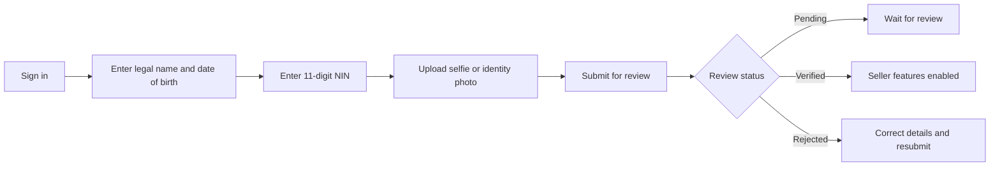

# Seller KYC onboarding

Seller verification is required before creating a listing. The `/kyc` flow collects your legal name, date of birth, Nigerian National Identification Number (NIN), and a selfie or identity document photo.

## Before you start

- Use the legal name and date of birth shown on your identity document.
- Have your 11-digit NIN ready.
- Prepare a clear JPEG or PNG image no larger than 5 MB. The current form accepts image files only; PDF documents are not accepted.
- Sign in to your AirFlex account before submitting.

## Submission flow

Open **Complete KYC** in the app, complete each step, and submit the form. The server stores the submission as **Pending** while it is reviewed. The project does not publish a review-time estimate, so allow time for manual review and check the KYC status in your profile.

## If a submission is rejected

The current submission endpoint accepts a new application after a rejection, but does not return a reviewer rejection reason. Before resubmitting, first rule out the form issues it can detect:

- The legal name must contain at least a first and last name, and the date of birth must be a valid date in the past.
- The NIN must contain exactly 11 digits.
- A selfie or identity photo is required; it must be JPEG or PNG and no larger than 5 MB.

Also make sure the details match your identity document and the image is readable and complete. The app does not currently provide a reason code for reviewer decisions, so it cannot identify the exact cause of a rejection. A new submission returns to **Pending** for review.

The form accepts a selfie or identity document photo; it does not currently list document classes such as passport or driver's licence separately. Use the document requested by the in-app instructions. Do not submit another person's identity details.

## Statuses

| Status | Meaning |
| --- | --- |
| Unverified | No approved verification is on file. |
| Pending | The submission has been received and is awaiting review. |
| Verified | Seller verification is approved. |
| Rejected | The submission was not approved; correct the details and submit again. |

KYC documents and identifiers are sensitive personal information. Upload them only through the authenticated AirFlex form.
