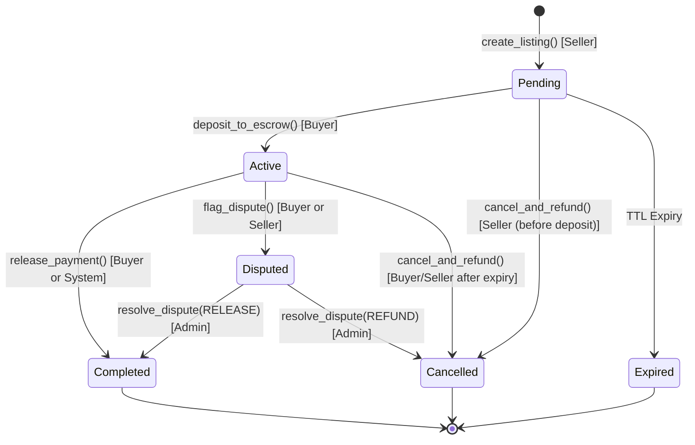

# AirFlex Soroban Contracts Audit Preparation Document

This preparation document provides security auditors with comprehensive scope, architecture details, access control matrices, state machine definitions, and known risk areas for the AirFlex Soroban smart contracts.

---

## 1. Scope

### Contract Files
- **Escrow Contract**: `contracts/escrow/src/lib.rs` (Escrow & partial fill engine)
- **Marketplace Contract**: `contracts/marketplace/src/lib.rs` (Peer-to-peer listing & reputation contract)

### Commit Range & Target Network
- **Target Network**: Stellar Mainnet / Testnet (Soroban Protocol Version 20+)
- **Commit Range**: `HEAD` (Latest main commit)

---

## 2. Architecture Overview & State Machine

AirFlex peer-to-peer airtime/data trades transition through discrete states defined by `TradeStatus`.

### `TradeStatus` State Machine Diagram

### Transition Triggers & Rules

| From State | To State | Trigger Function | Triggering Role | Conditions / Invariants |
|---|---|---|---|---|
| `[*] ` | `Pending` | `create_listing` | Seller | Funds/Asset listing initialized; valid expiry duration. |
| `Pending` | `Active` | `deposit_to_escrow` | Buyer | Buyer locks full/partial fill amount in Soroban escrow. |
| `Pending` | `Cancelled` | `cancel_and_refund` | Seller | Listing cancelled before buyer locks escrow; funds unlocked. |
| `Pending` | `Expired` | System / Time | Anyone | Block timestamp > `expires_at`. |
| `Active` | `Completed` | `release_payment` | Buyer / System | Delivery verified on-chain or buyer confirms receipt; payment released to seller. |
| `Active` | `Disputed` | `flag_dispute` | Buyer / Seller | Raised when off-chain delivery is contested before expiry. |
| `Active` | `Cancelled` | `cancel_and_refund` | Buyer / Seller | Triggered after expiry window without delivery confirmation. |
| `Disputed` | `Completed` | `resolve_dispute` | Admin | Admin resolves dispute in favor of seller (RELEASE). |
| `Disputed` | `Cancelled` | `resolve_dispute` | Admin | Admin resolves dispute in favor of buyer (REFUND). |

---

## 3. Access Control Matrix

| Contract Function | Anyone | Seller | Buyer | Admin | System |
|---|:---:|:---:|:---:|:---:|:---:|
| `initialize(admin, allowed_tokens)` | ❌ | ❌ | ❌ | ✅ (One-time) | ❌ |
| `pause()` | ❌ | ❌ | ❌ | ✅ | ❌ |
| `unpause()` | ❌ | ❌ | ❌ | ✅ | ❌ |
| `add_allowed_token(token)` | ❌ | ❌ | ❌ | ✅ | ❌ |
| `remove_allowed_token(token)` | ❌ | ❌ | ❌ | ✅ | ❌ |
| `create_listing(token, amount, price, ...)` | ❌ | ✅ | ❌ | ❌ | ❌ |
| `deposit_to_escrow(trade_id, fill_amount)` | ❌ | ❌ | ✅ | ❌ | ❌ |
| `release_payment(trade_id, fill_id)` | ❌ | ❌ | ✅ | ❌ | ✅ |
| `cancel_and_refund(caller, trade_id)` | ❌ | ✅ | ✅ | ❌ | ❌ |
| `flag_dispute(caller, trade_id)` | ❌ | ✅ | ✅ | ❌ | ❌ |
| `resolve_dispute(trade_id, resolution)` | ❌ | ❌ | ❌ | ✅ | ❌ |
| `get_trade(trade_id)` | ✅ | ✅ | ✅ | ✅ | ✅ |
| `get_listing(listing_id)` | ✅ | ✅ | ✅ | ✅ | ✅ |
| `get_reputation(user)` | ✅ | ✅ | ✅ | ✅ | ✅ |
| `is_paused()` | ✅ | ✅ | ✅ | ✅ | ✅ |

---

## 4. Known Assumptions and Limitations

1. **Off-Chain Telecom Delivery Verification**: The smart contract relies on an off-chain oracle service (or mutual agreement / automated verification processor) to verify telco airtime/data top-ups.
2. **Soroban Persistent Storage TTL**: Storage entries (`DataKey::Trade`, `DataKey::Listing`) must be bumped periodically to prevent archival.
3. **No Dynamic Price Feeds On-Chain**: Trade prices are fixed at listing creation time in NGN/XLM equivalent.
4. **Dispute Cooldown Window (Issue #642)**: `flag_dispute` enforces a `dispute_cooldown_seconds` window (default `3600`, set at `initialize`) per trade to prevent dispute-spam griefing; see [THREAT_MODEL.md §6](./THREAT_MODEL.md) and `ContractError::DisputeCooldownActive` in [ERROR_CODES.md](./ERROR_CODES.md).

---

## 5. External Dependencies

- **Soroban SDK**: `soroban-sdk` version `20.0.0` or higher.
- **Stellar Asset Contract (SAC)**: Standard Soroban token contract interface for ERC-20 / SAC asset transfers (`token::Client`).

---

## 6. Test Coverage Summary

- **Unit Tests**: Full state transition coverage in `contracts/escrow/src/lib.rs` tests and `contracts/marketplace/src/lib.rs` tests.
- **Integration Tests**: Simulated full lifecycle runs (listing creation → escrow lock → dispute → resolution / refund).
- **Error Code Invariants**: Verified in accordance with [ERROR_CODES.md](./ERROR_CODES.md).

---

## 7. Questions for Auditors

1. **Storage Entry Expiry & TTL Edge Cases**: Are there any race conditions where `DataKey::Trade` entries expire during an active dispute before `resolve_dispute` is executed?
2. **Partial Fill Arithmetic & Precision Loss**: When a trade is partially filled across multiple buyers, can rounding issues or integer overflow occur in `amount * price` calculations?
3. **Replay & Front-Running Vulnerabilities**: Does `deposit_to_escrow` allow front-running by malicious buyers when gas prices fluctuate or during network congestion? **Replay mitigation (Issue #512)**: `deposit_to_escrow` binds the buyer's signature to the exact invocation via `require_auth`, and the dedicated `purchase_with_auth(env, buyer, listing_id, auth_nonce)` path enforces a strictly-increasing per-buyer nonce (`DataKey::BuyerNonce`) so any off-chain-signed purchase authorization is single-use — replay is rejected with `ContractError::InvalidNonce`. See [THREAT_MODEL.md](./THREAT_MODEL.md) → Marketplace Authorization Replay Attacks.
4. **Reentrancy Protection**: Are token transfers via `token::Client` safe against reentrancy if custom SAC tokens execute callbacks?

---

## 8. Error Codes Reference

For a complete breakdown of contract error codes and custom panic signals, see [ERROR_CODES.md](./ERROR_CODES.md).

---

## 9. On-Chain Event Observability (Issues #638, #639)

In addition to the state recorded in `DataKey::Trade`, the escrow contract
now emits a canonical `EscrowCreated` / `EscrowReleased` / `EscrowRefunded` /
`EscrowDisputed` event for every state transition, each carrying
`(escrow_id, actor, amount, timestamp)` — see the
[escrow README's Events section](./escrow/README.md#events-issues-638-639) for the
full topic table. Auditors can use these events, instead of polling
`get_trade`, to reconstruct a trade's full history on-chain.
`server/src/services/stellar.ts` (`subscribeToEscrowEvents`,
`fetchEscrowEvents`) reads and parses them via Soroban RPC's `getEvents` for the
backend oracle and indexers.

Points for auditors:

- **Dispute rulings emit settlement events.** `resolve_dispute` publishes one
  `EscrowReleased` or `EscrowRefunded` per settled fill, the same as
  `release_payment` and `cancel_and_refund`. Before issue #638 it emitted only
  the short-form `resolved` topic, so settled funds were missing from the
  canonical stream.
- **Conservation check.** For any escrow, the amounts in `EscrowReleased` plus
  `EscrowRefunded` equal the sub-escrow amounts settled so far. `actor` on both
  is the recipient of the funds, not the caller.
- **Not covered.** `deposit_to_escrow` (short-form `locked`),
  `close_expired_listing` (`cancelled`) and `emergency_withdraw`
  (`emergency_withdrawal`) have no canonical event. An emergency withdrawal
  breaks the conservation check above by design.
- **Events are not authenticated state.** Consumers must match the emitting
  contract ID and treat `get_trade` as the source of truth.

---

## 10. Fuzzing (Issue #644)

`contracts/fuzz` holds two cargo-fuzz targets, run for 60 seconds each in CI by
`make fuzz`:

| Target | Code under test |
|---|---|
| `escrow_arithmetic` | `contracts/escrow/src/arithmetic.rs` — fill bounds, partial-fill splits, refunds, deadlines |
| `marketplace_validation` | `contracts/marketplace/src/arithmetic.rs` — price/quantity checks, offer expiry, reputation totals |

The contracts call these modules for their arithmetic, and the targets compile
the same source files. Neither contract charges a fee, so the split under test
is the division of a listing across partial fills.

Arithmetic hardened as part of this work:

- Marketplace `total_volume += volume` could overflow `i128` and trap inside
  `release_payment` or `resolve_dispute`, leaving the buyer's funds in escrow.
  It now saturates, as do the reputation counters.
- Escrow `refunded_amount += sub.amount` is now checked and returns
  `InsufficientFunds`.
- `now + window` and `paused_at + timelock` deadlines in both contracts now
  saturate.
